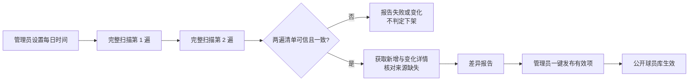

# PESDATA 球员库每日对账与受控发布设计

日期：2026-10-23
状态：待用户确认，尚未实施

## 目标与时间口径

管理员在后台设置每日开始时间和时区，并可启停定时任务。每天到点后，系统读取 PESDATA 的完整球员卡编号清单，识别新增、可发现的内容更新、来源缺失和失败项。管理员查看差异报告后，点击一次“发布有效变更”；公开球员库才显示新增与更新，并隐藏已确认下架的卡。用户确认：每天完整核对卡片编号的新增与下架；现有卡的详细资料和图片分批复核，不要求当天逐张核对完毕。

当前接入的来源列表采用偏移量分页，没有可锁定的快照编号或删除事件。设置的时间是**扫描开始时间**，不是“该秒钟官网状态的原子快照”；两遍扫描、详情复核和人工发布都需要时间。系统只承诺与本次可信扫描确认的来源清单对齐，并显示扫描窗口、发布时间及未解决差异，不宣称与官网实时绝对一致。

## 已讨论的办法与选择

| 办法 | 优点 | 代价 |
| --- | --- | --- |
| 两遍完整扫描且单卡接口明确报告已失效，才允许下架 | 最能防止来源短暂漏页造成误下架 | 来源不提供明确失效信号时，真实删卡可能长期留在待确认 |
| **两遍可信扫描，并在连续两个自然日都缺失后允许下架** | 即使单卡接口只返回含糊的错误，也能在第二天识别官网删卡 | 来源连续两天都遗漏同一批数据仍可能误判；需异常阈值和管理员审阅 |
| 一次扫描缺失即下架 | 当天最快 | 请求失败、分页变化或漏页可能大面积误下架，不采用 |

采用第二种：用户选择“连续两天完整扫描仍缺失就允许下架”，并保留此前选定的“管理员看差异报告后一键发布”。

## 可信扫描与删除判定

1. 每遍按来源 `count`、偏移量和固定页大小读完列表。持久化每页偏移、来源总数、返回条数、编号摘要及每张卡的编号和列表摘要。页内或跨页编号重复、空白中间页、偏移不连续、总数中途变化、唯一编号数不等于来源总数，均使本遍不可信。
2. 第二遍从头开始，要求总数和**完整编号集合**与第一遍一致；只比较数量不够。两遍不一致时本次不产生可发布下架项，保留错误和扫描报告。任务可在有界预算内重新开始，不能沿用不完整页面。
3. 对本地已发布且本次两遍都缺失的卡，先请求单卡详情：明确 `is_del=1` 的记录可确认为下架；可正常读到有效详情的卡列为冲突，不能下架；超时、404、空结果或协议异常本身不算确定删除。
4. 对详情结果含糊的缺失卡，只有**两个相邻的本地业务日期**各有一次独立、完整、可信的双遍扫描，且两个日期均缺失，才列为“连续缺失两天，可下架”。业务日期以管理员设置的时区及该次定时任务的计划开始时间计算；扫描跨过午夜也只计入其计划开始的日期。任何一天没有可信扫描，连续计数中断。手动重跑同一天不能充当第二天。
5. 如果来源总数为零而本地仍有卡，或本次缺失比例超过可配置的异常阈值，本次所有缺失项暂停下架，后台提示人工核对来源。阈值不自动放宽；真实大批量删除可由管理员在核实后逐项确认，留下原因与审计记录。
6. 发布前重新核对该运行仍是最新可信结果、候选卡未在后续可信扫描中重现、各批次仍可发布。下架只发布 `INACTIVE` 新版本；不物理删除卡、历史版本、持有、收藏、阵容及交易记录。重新出现的同一来源编号沿用原卡 ID 发布 `ACTIVE` 版本。

这里的“两个自然日”按管理员设置的时区计算，界面同时显示日期和实际扫描时间。来源出现大幅变化时优先显示“待确认”，不会把无法解释的差异写成“已与官网一致”。

## 新增、更新与详情复核

- 身份使用 `sourceId + PESDATA playerId`；`base_pes_id` 仅用于关联现实球员。新编号创建卡，旧编号且业务字段变化创建新版本，无变化不重复创建版本。
- 每日完整扫描**列表编号**两遍；只对新增、列表摘要变化、上次失败及轮转复核对象请求详情。列表摘要不变但详情内容变化，只有轮转复核读到详情后才能发现。后台显示最近详情复核时间及详情尚未复核的卡片数量，使管理员看得出资料更新的滞后范围。
- 图片 URL 不变而图片内容变化，不能仅凭 URL 判断；若业务要求当天所有能力值、图片内容都严格一致，需要来源提供可信变更流，或允许每天抓取所有卡的详情及图片。当前请求速率下全量详情约需十余小时，不能承诺在设定时刻完成。
- 失败记录保持 `FAILED`，不进入一键发布。新增或更新批次只有校验通过后才可发布；部分批次失败时报告“部分生效”，不可标记“完全一致”。

## 后台操作与每日调度

球员同步页面新增“每日对账”设置：启用开关、时区、每日开始时间、下次预计启动时间、最近扫描窗口和最近发布结果。默认关闭；首次启用前须完成一次人工全量导入与数据核对。只有平台管理员可修改设置，变更写审计记录。

API 常驻实例按分钟检查到期设置，数据库用 `sourceId + 业务日期` 唯一键和既有租约保证多实例只创建一次；进程重启后可继续未完成分片。生产部署需保持至少一个 API 实例常驻，否则设定时间无法由容器内调度器触发。已有手动同步、暂停、继续、取消入口继续可用。

报告显示来源卡数、本地公开卡数、可信度、新增、更新、不变、明确下架、连续缺失两天下架、待确认、失败各类数量和可读名称。管理员可逐项查看证据；“一键发布有效变更”在服务端重新验证运行与项目状态，跳过失败和待确认项，按现有受控批次发布并显示每批结果。发布后只读比较可信来源编号集合与公开 `ACTIVE` 编号集合；只要仍有待确认或失败，就展示未对齐的数量与原因。

## 容量、数据安全与上线

扫描页、编号和差异按 `runId` 分块写表，在数据库内比较两遍集合，避免把数万编号同时搬入 API 内存。暂存表按精确运行 ID 保留与归档；清理前核对关联、备份并事务化执行，不按宽泛日期直接删除。限速、请求预算、超时和异常阈值需可配置；连续失败必须保留可诊断报告。

实现与测试都在 `dev`。API/e2e 测试仅连接显式指定的本机隔离 `test/verify` 数据库；用模拟 50,000 张卡覆盖新增、更新、缺页、重复、跨日缺失、当天重跑、重现、批次失败与幂等。发布到目标环境前只读运行 `pnpm db:status`，先迁移再部署 API/后台。复测后台“现役球队／已退出”、球队详情、小程序“我的联赛”、球员库、已持有卡、收藏和交易历史。新调度初始保持关闭；目标环境手动完成一次可信扫描、审核、发布及公开集合核对后再启用。

## 验收口径

- 管理员可自行设置每日开始时间与时区；同一天即使多实例和重启也只创建一次定时运行。
- 两遍完整扫描可信且一致时，新增与已验证更新进入差异报告；管理员发布后公开列表生效。
- 一次缺失、扫描失败、漏页、来源波动、单卡详情含糊，均不能直接下架；连续两个相邻日期可信扫描都缺失的卡才允许进入下架候选。
- 已确认下架的卡在发布后从公开球员库消失，历史关联保留；再次出现时用原 ID 恢复。
- 报告准确区分扫描完成、待发布、部分生效、完全生效和未对齐，显示扫描与发布时间。
